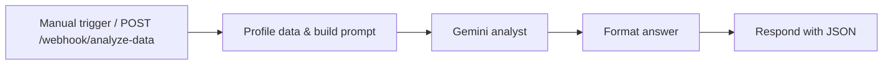

# Data Analyst Agent (n8n)

Send a CSV and a plain-English question; get back an analysis written by Google Gemini.
The numbers are computed by code first, so the model never has to do arithmetic on raw data.



## How it works

1. **Profile Data & Build Prompt** (Code node, source in [`profile_data.js`](profile_data.js)) parses the CSV (quoted fields supported) and computes per-column statistics: min, max, sum, mean and median for numbers; top values for text; missing and unique counts; plus a few sample rows.
2. **Gemini Analyst** sends the profile and your question to `gemini-2.5-flash`.
3. **Format Answer** returns `{ question, answer, rows, columns }`.

Run it with no input and it analyses a built-in sample sales dataset.

## Setup

1. Create a **Google Gemini (PaLM) API** credential in n8n with your key from [Google AI Studio](https://aistudio.google.com/apikey).
2. **Workflows → Import from file** → [`Data_Analyst_Agent.json`](Data_Analyst_Agent.json), then select that credential in the *Gemini Analyst* node.
3. Click **Test workflow**, or activate it and call the webhook:

```bash
curl -X POST https://<your-n8n>/webhook/analyze-data \
  -H "Content-Type: application/json" \
  -d '{"csv": "region,revenue\nEU,100\nUS,250", "question": "Which region performs best?"}'
```

No API key is stored in the workflow file.

## Development

The workflow JSON is generated. Edit [`profile_data.js`](profile_data.js) or [`generate_workflow.py`](generate_workflow.py), then:

```bash
python generate_workflow.py
python test_workflow.py     # 6 tests; the profiler tests need Node.js
```

## Limitations

- The model sees the column profile and up to 10 sample rows, not the whole file, so questions about specific rows may be answered incompletely.
- Comma-delimited CSV only.
- Each run is one Gemini Flash call (a fraction of a cent).

## Status

Verified on 2026-10-27 on a self-hosted n8n: profiling, prompt building, answer formatting and webhook response, with the Gemini response mocked; all 6 Python tests passing.

## License

MIT, see [LICENSE](LICENSE). Built by [CyberResonance](https://cyberresonance.io).
